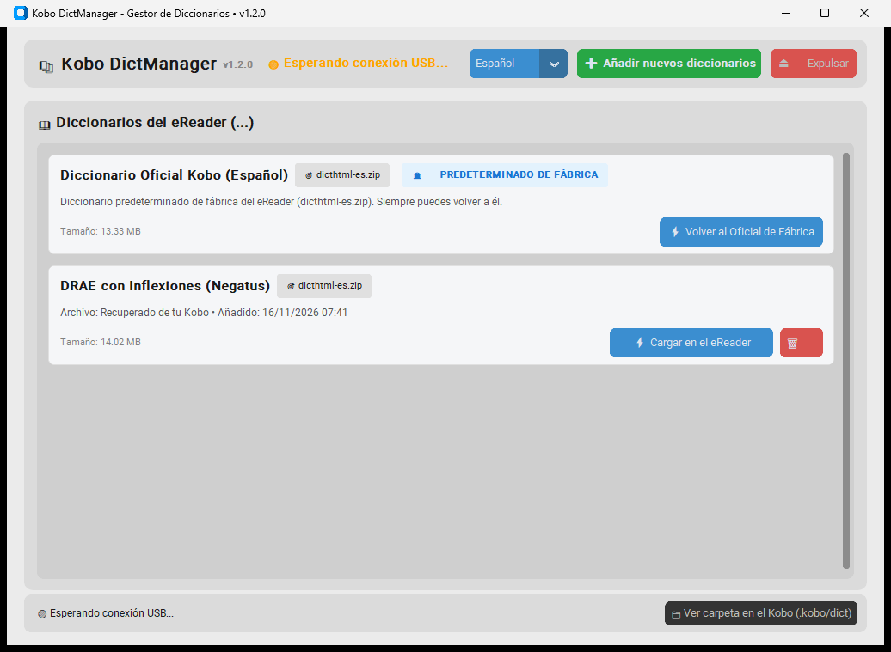

# Kobo DictManager

A modern, open-source desktop utility for Windows to effortlessly manage, switch, and protect custom dictionaries on Kobo eReaders.

<p align="center">
  
</p>

---

## ⚡ Quick Download (Standalone Executable)

If you just want to use the application without installing Python:

1. Download **`KoboDictManager.exe`** from the [Latest Releases](https://github.com/neoruben/kobo-dict-manager/releases).
2. Double-click the `.exe` to launch. No Python or extra dependencies required!

---

## ✨ Features

- **Automatic Kobo Detection:** Automatically scans and detects connected Kobo devices over USB (`.kobo` directory verification).
- **Language-Aware Slot Matching:** Detects your Kobo device's interface language directly from configuration (`CurrentLocale`), targeting the appropriate dictionary slot (e.g., `dicthtml.zip` for English, `dicthtml-es.zip` for Spanish, `dicthtml-fr.zip` for French, etc.).
- **Wi-Fi Overwrite Protection:** Protects active custom dictionaries from being overwritten by Kobo's background Wi-Fi sync by setting read-only file attributes.
- **Factory Integrity & Backup:** Safely backs up the genuine factory dictionary on initial connection and uses SHA-256 verification to prevent custom dictionaries from ever being mistaken for factory defaults.
- **Library Management:** Add, preview, delete, and switch between multiple custom dictionaries with duplicate detection.
- **Centralized & Persistent Storage:** User libraries, catalog entries, and backups are stored centrally in `%APPDATA%\KoboDictManager`, ensuring your dictionaries are never lost when moving or updating the `.exe`. An optional portable mode can be activated with a `portable.dat` file.
- **Smooth Visual Feedback:** Real-time progress bar when transferring dictionaries to and from the eReader.
- **Multilingual UI:** Automatically detects system language with full support for Spanish, English, Catalan, Galician, Basque, French, German, Italian, and Portuguese.
- **Modern UI:** Built with CustomTkinter with support for dark and light appearance modes.

---

## ⚠️ Compatibility & Tested Devices

> [!IMPORTANT]
> **Tested Device:**
> Currently, **Kobo DictManager** has only been tested on a **Kobo Clara BW** (running Firmware 4.46+).
> 
> While it is designed to follow standard Kobo USB and storage conventions across all modern Kobo models (such as Libra 2, Libra Colour, Clara 2E, Clara Colour, Sage, Nia, etc.) and all interface languages (`dicthtml.zip`, `dicthtml-fr.zip`, `dicthtml-de.zip`, etc.), **it has not yet been verified on other hardware models**.
> 
> **📢 If you test or get this working on another Kobo model or in other languages, please let us know by opening an [Issue](https://github.com/neoruben/kobo-dict-manager/issues) or Discussion!** Your feedback helps verify support for the entire Kobo lineup.

---

*(Aviso en español: De momento la aplicación **sólo ha sido probada en un Kobo Clara BW** (firmware 4.46+) y con diccionarios en español (`dicthtml-es.zip`). Si tienes otro modelo de Kobo (Libra, Sage, Nia, Clara 2E/Colour, etc.) o lo pruebas con otros idiomas y te funciona, **por favor abre un Issue o avísanos en GitHub** para confirmarlo y añadirlo a la lista de dispositivos compatibles).*

---

## 📋 Requirements (Running from Source)

- Windows 10 / 11
- Python 3.10 or newer

Dependencies:
- `customtkinter>=5.2.0`

---

## 🚀 Running from Source

1. **Clone the repository:**
   ```bash
   git clone https://github.com/neoruben/kobo-dict-manager.git
   cd kobo-dict-manager
   ```

2. **Install dependencies:**
   ```bash
   pip install -r requirements.txt
   ```

3. **Run the application:**
   ```bash
   python kobo_dict_manager.py
   ```
   *Or double-click `Iniciar_KoboDictManager.bat`.*

---

## 📖 How to Use

1. Connect your Kobo eReader to your PC via USB and tap **Connect** on the device screen.
2. Launch **Kobo DictManager**. The app will detect your Kobo and display its current language slot.
3. Click **Add New Dictionary** to import a custom `.zip` or `.rar` dictionary file into your local library.
4. Select the dictionary you want and click **Load into eReader** (or **Activate on Kobo**).
5. When finished, click **Eject** or safely eject your Kobo eReader before unplugging the USB cable.

---

## 🛡️ License

This project is licensed under the [MIT License](LICENSE).
